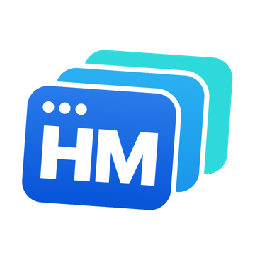
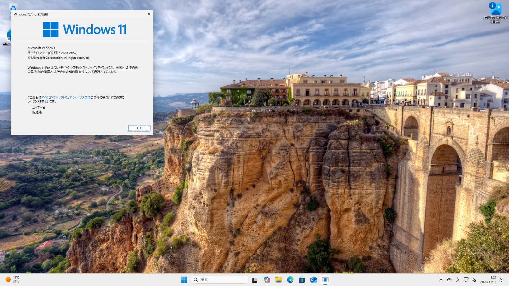
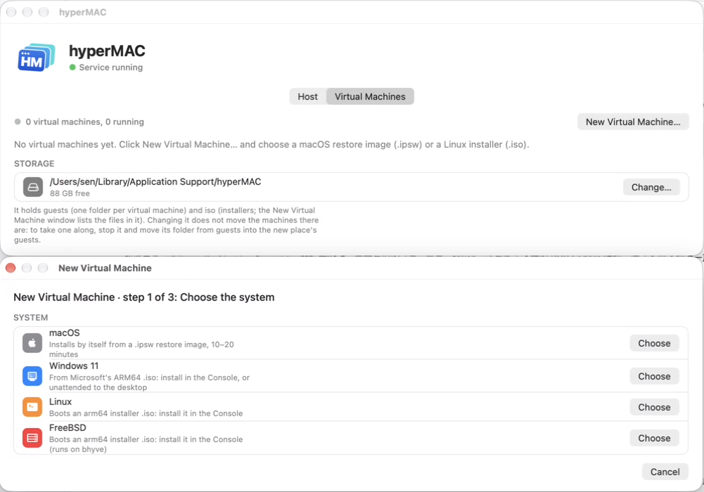
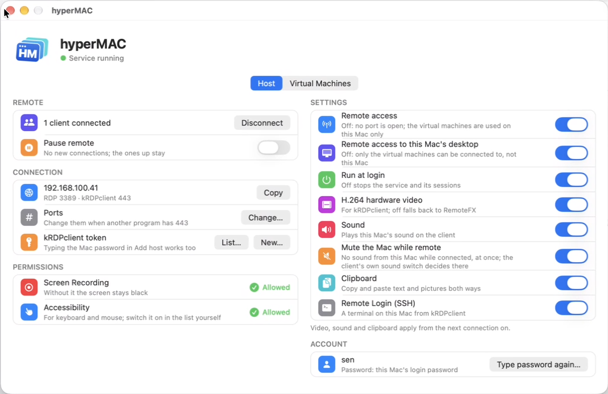
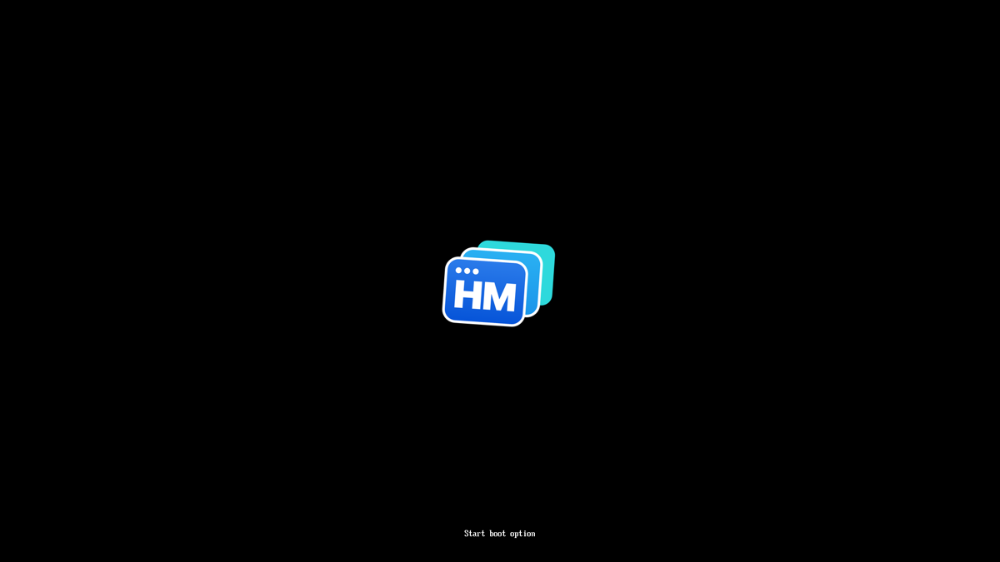
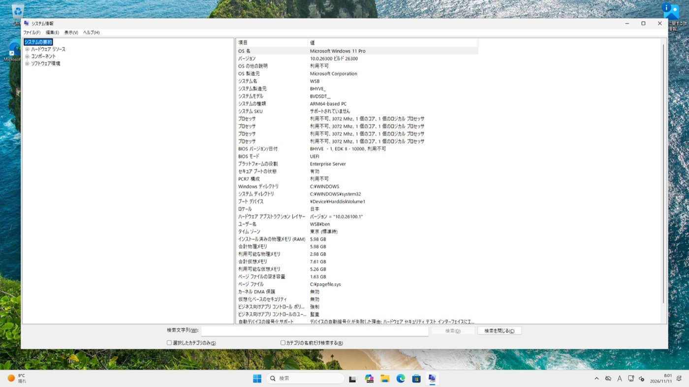

<p align="center"></p>
<h1 align="center">hyperMAC</h1>
<p align="center"><b>Windows 11 on your Mac in three clicks. Free, open source, no QEMU.</b><br>
bhyve on Apple Silicon + Apple's Virtualization.framework + a built-in RDP server, in one app.</p>
<p align="center"><a href="https://github.com/keelos-dev/hyperMAC/releases">Download</a> · <a href="#windows-11-in-three-steps">Windows 11 in three steps</a> · <a href="#how-it-compares">How it compares</a> · <a href="README.zh-CN.md">中文</a></p>



hyperMAC does two things, and they fit together:

1. **A hypervisor.** macOS, Windows 11 ARM, Linux and FreeBSD guests on Apple Silicon. Windows and
   FreeBSD run on **bhyve**, FreeBSD's hypervisor, ported to Apple's Hypervisor.framework: as far
   as we know the first bhyve on Apple Silicon. macOS and Linux guests run on Apple's own
   Virtualization.framework.
2. **An RDP server.** Your Mac's own desktop and every virtual machine are reachable with plain RDP:
   Windows' built-in `mstsc` connects with nothing to install. A Mac mini in a closet becomes a
   Windows-and-Mac server you use from any PC.

Don't want the second part? One switch closes every port, and it is just a local hypervisor.

| New Virtual Machine: pick a system | The Mac itself: remote access, one switch each |
|---|---|
|  |  |

## Why you might want it

- **Windows 11 ARM installs from Microsoft's own ISO, unmodified.** The machine has a TPM 2.0 and
  Secure Boot, so the installer's hardware checks pass as they are: no registry tricks, no patched
  image. Choose "unattended" and you are at the desktop in about 8 minutes on an M4, account made,
  network up.
- **Free and open source.** MIT; the bhyve port BSD-2-Clause. No subscription, no account, no
  telemetry.
- **Small and native.** One app of about 30 MB: Rust and C, no QEMU, no kernel extension, no
  background daemon running as root. A virtual machine is one ordinary process.
- **Headless by design.** Virtual machines open no window on the Mac and keep running when the
  app's window closes. Look at them in a console window, or from another computer over RDP.
- **Two engines, each where it is best.** Apple's Virtualization.framework for macOS and Linux
  (it is what Apple supports). bhyve for Windows and FreeBSD, where Virtualization.framework
  does not go.

## Windows 11 in three steps

1. Get two files: the **Windows 11 ARM64 ISO** from
   [Microsoft](https://www.microsoft.com/software-download/windows11arm64) and the
   [virtio-win driver ISO](https://fedorapeople.org/groups/virt/virtio-win/direct-downloads/)
   (the network driver). Put them in Downloads.
2. Open hyperMAC → **Virtual Machines** → **New Virtual Machine…** → **Windows 11**. It finds both
   files by itself.
3. Click **Create**, then **Start**. Install as on a real PC in the console window; or switch on
   "unattended", type a user name and password, and come back in 8 minutes.

That is all. No TPM bypass, no "this PC can't run Windows 11".

| The firmware shows where you are | Windows agrees it is a real, secure PC |
|---|---|
|  |  |

macOS guests are as short: **New Virtual Machine… → macOS → Download the newest macOS from
Apple**, and it installs by itself. Linux and FreeBSD: point it at the distribution's arm64 ISO.

## What runs

| Guest | Engine | How it installs | State |
|---|---|---|---|
| **Windows 11 ARM** | bhyve on Hypervisor.framework | Microsoft's ISO: by hand, or unattended | TPM 2.0, Secure Boot, network, 1920x1080, Windows Update |
| **macOS** | Virtualization.framework | by itself, from Apple's restore image (downloaded for you) | as Apple's framework gives it |
| **Linux** (arm64) | Virtualization.framework | the distribution's ISO | Fedora tested |
| **FreeBSD** (arm64) | bhyve on Hypervisor.framework | the release's ISO | 15.1 tested |

## How it compares

From each project's public documentation, 2026-11; not all tested side by side. Corrections are
welcome as an issue.

| | **hyperMAC** | UTM | Parallels Desktop | VMware Fusion | VirtualBox |
|---|---|---|---|---|---|
| Price | free | free | paid subscription | free | free |
| Open source | ✅ MIT / BSD | ✅ | ❌ | ❌ | ✅ (GPL) |
| What runs the guest | bhyve on Hypervisor.framework; Apple VZ | QEMU; Apple VZ | its own | its own | its own |
| Windows 11 ARM | ✅ | ✅ | ✅ | ✅ | ✅ (7.2 and later) |
| macOS guests | ✅ | ✅ | ✅ | ❌ | ❌ |
| 3D acceleration in Windows | ❌ not yet | ❌ | ✅ | ✅ | ❌ |
| RDP to the Mac's own desktop and to every VM | ✅ built in | ❌ | ❌ | ❌ | VMs only (VRDE) |

Honestly: if you need games or 3D in Windows, Parallels is ahead and will be for a while. If you
want Windows 11 for Office, a browser, development tools or that one Windows-only program, on a
Mac that may not even have a screen attached, and you would rather not pay every year for it:
this is for you.

## The RDP server

hyperMAC began as an RDP server for the Mac itself, and that part is the mature one.

- **`mstsc` just connects** (`mac-address:3389`, your Mac's user name and password).
- With **[kRDPclient](https://github.com/keelos-dev/kRDPclient-releases)** (Windows, free) you get
  hardware H.264: 1080p at 30 fps (60 on a LAN), about 6–10 Mbps, with sound and the clipboard. It
  lists the Mac and each virtual machine; one click opens any of them.
- The login is your Mac account. No cloud service sits in between.
- Free, also where NoMachine no longer is: its version 10 dropped the free server edition, and a
  server now needs a yearly subscription, for personal use too.

### Compared with other remote desktops for the Mac

From each product's public description (2026-11); not all of them tested side by side.

| | hyperMAC | Apple Screen Sharing | NoMachine | Chrome Remote Desktop | RustDesk | Parsec |
|---|---|---|---|---|---|---|
| Protocol | RDP | VNC + Apple extensions | NX | WebRTC | own | own |
| Video codec | H.264 hardware (kRDPclient); RemoteFX / bitmaps (mstsc); sound Opus / PCM | VNC encodings (Raw/ZRLE/Tight…); HEVC in high-performance mode (Mac to Mac, Apple Silicon) | H.264, VP8 | VP8 / VP9 (WebRTC) | VP8 / VP9 / AV1, optional hardware H.264 / H.265 | H.264, H.265 |
| Windows' built-in mstsc connects | ✅ | ❌ | ❌ | ❌ | ❌ | ❌ |
| Account / cloud service needed | no | no | no (LAN) | Google account | no (self-hosted relay possible) | yes |
| Hardware video to a Windows client | ✅ H.264 (kRDPclient) | ❌ | ✅ | — | ✅ | ✅ |
| Smoothness (Windows client) | smooth: 1080p 30 fps (60 on a LAN), measured 7.6 ms decode, 6–10 Mbps, ~6 % Mac CPU | choppy (tested with TigerVNC) | smooth | fair | fairly smooth | very smooth (game-grade latency) |
| Sound | ✅ | high-performance mode only (Mac clients) | ✅ | ✅ | ✅ | ✅ |
| File transfer | ❌ (planned) | ✅ (Mac clients) | ✅ | ❌ | ✅ | ❌ |
| Works at the login window | ❌ | ✅ | ✅ | ✅ | ✅ | — |
| Price | free | built in | paid from version 10 on (also for personal use) | free | open source | free for personal use |

Pick hyperMAC when the other side is Windows and you want plain RDP (mstsc with nothing to install,
or kRDPclient for hardware H.264), with no cloud account in between.

### Features by macOS version

✅ tested on a real Mac · ☑️ should work, not yet tested on this version · — not tested

| Feature | 13–15 | 26 | 27.2 |
|---|:-:|:-:|:-:|
| kRDPclient: login, H.264 hardware video | — | ✅ | ✅ |
| mstsc / standard RDP clients (RemoteFX) | — | ✅ | ☑️ |
| Keyboard and mouse (input methods work) | — | ✅ | ✅ |
| Sound (Opus to kRDPclient, PCM to mstsc) | — | ✅ | ☑️ |
| Clipboard: text | — | ✅ | ☑️ |
| Clipboard: pictures | — | ✅ | ✅ |
| Found by kRDPclient's "Discover keelOS" | — | ✅ | ☑️ |
| Runs in the background, starts at login | — | ✅ | ✅ |
| Permissions kept across a macOS upgrade | — | — | ✅ (26 → 27.2) |
| App, first-run setup, Check for Updates | — | ✅ | ☑️ |

## Install

1. Download the newest `.dmg` from [Releases](https://github.com/keelos-dev/hyperMAC/releases) and
   open it. It is signed and notarized.
2. Drag **hyperMAC** into **Applications** and open it.
3. First run: type your Mac's login password once (that is what remote clients log in with) and
   allow **Screen Recording** and **Accessibility**. Only want virtual machines? Click
   **Virtual Machines Only** on that page and skip both.

Requirements: a Mac with Apple Silicon. Tested on macOS 26 and 27. Intel Macs are not supported.

## Which RDP client

**kRDPclient is the recommended client**: https://github.com/keelos-dev/kRDPclient-releases
(Windows). In kRDPclient choose "Add keelOS host", enter the Mac's address and your Mac's
login password (kRDPclient trades it for a token and does not keep the password), or a token made
in the hyperMAC app. It gets the picture as hardware-encoded H.264, plus sound and the clipboard.

mstsc (Remote Desktop Connection) and other standard RDP clients can connect too
(`mac-address:3389`, your Mac user name and login password), **but they have no H.264 channel**:
the picture goes as RemoteFX / bitmaps and is noticeably less smooth. If mstsc feels slow, try
kRDPclient before judging hyperMAC.

### Limits of the RDP server

- A user must be logged in on the Mac: at the login window (after a restart without automatic
  login) nobody can connect. Turn on automatic login in System Settings → Users & Groups.
- The Mac needs a display, or a dummy plug (HDMI headless adapter); with nothing attached macOS
  has no screen to capture.
- Clipboard: text and pictures (screenshots, copied images), no files yet.
- The mouse pointer is part of the picture; there is no client-side pointer yet.
- The login is your Mac account, so anyone who knows your Mac password can connect: use a good
  one, and keep port 3389/443 inside your network. hyperMAC does not store the password; for mstsc
  it keeps the password's NT hash in a file only your account can read. After changing the Mac
  password, the old one stops working at once; mstsc needs one login with the new one from
  kRDPclient (or open hyperMAC and type it), kRDPclient works right away.
- Updates are not checked by themselves: use "Check for Updates…" in the app.

## What is rough

- **This is young.** The virtual machine part is brand new. Keep copies of anything important.
- No graphics acceleration in Windows (the basic display driver, up to 1920x1200) and no sound
  from virtual machines yet.
- Bridged networking, sleep/wake and long uptimes are not tested enough.
- The firmware's Secure Boot keeps its keys where the guest's kernel could reach them (the EDK2
  platform has no protected variable store): enough for Windows' requirements, not the strength
  of a real PC's.

## For the curious: bhyve on Apple Silicon

[xhyve](https://github.com/machyve/xhyve) brought bhyve to Intel Macs in 2015. `vm/bhyve` here is
the arm64 story:

- FreeBSD's `usr.sbin/bhyve` sources **unchanged**, with a numbered patch series on top and a small
  compatibility layer, so following FreeBSD head stays cheap.
- `libvmmapi` reimplemented over **Hypervisor.framework** (`vm/bhyve/hvf`, about 2,000 lines):
  vCPUs, the framework's in-kernel GICv3, MSIs through a GICv2m frame, instruction decoding for
  the MMIO accesses the CPU does not describe.
- What arm64 bhyve did not have and Windows needs: **UEFI** (EDK2), **ACPI** tables, a CFI flash
  for UEFI variables, QEMU's fw_cfg and ramfb, the **virtio 1.0** transport, a **TPM** (libtpms
  inside the process), Secure Boot.
- Eighteen of the patches are written for FreeBSD review, bugs found on the way included
  (`vm/bhyve/patches/REVIEW.md`). Nothing has been submitted yet.

## Update

Open hyperMAC and click "Check for Updates…" (under About). If there is a newer version it shows
what changed; "Update" downloads it, checks that it is signed by hyperMAC's developer and notarized
by Apple, replaces the app and restarts the service (a session in progress drops for a few
seconds). The permissions carry over.

By hand: quit hyperMAC's window first (⌘Q; Finder does not replace an app whose window is open:
"hyperMAC is in use"), drag the new hyperMAC over the old one, then open it. The background service
may keep running.

### Uninstall

1. Open hyperMAC and choose "Uninstall the login item".
2. Delete hyperMAC from Applications and the folder `~/Library/Application Support/hyperMAC`.
3. Optionally remove hyperMAC from Screen Recording and Accessibility in System Settings.

Remote Login (SSH) is a macOS setting and is left as it is; turn it off in System Settings →
General → Sharing if you no longer need it.

## Building from source

Needs Xcode's command line tools, Rust (rustup, stable) and Python 3; for the TPM of Windows
machines also `brew install libtpms openssl` (without them bhyve builds without a TPM).

```sh
sh build.sh        # target/release/hypermac, vm/target/release/hypermac (the VM program), vm/bhyve/build/bhyve
```

`build.sh` signs with the first "Apple Development" identity in the keychain when there is one
(the two permissions then survive a rebuild), else ad hoc. `target/release/hypermac install` sets
it up to run at login. How the parts fit together, and the release packaging, are in
[docs/DEVELOPING.md](docs/DEVELOPING.md) (in Chinese); the virtual machines in
[vm/README.md](vm/README.md) and [vm/bhyve/README.md](vm/bhyve/README.md).

This repository receives a snapshot per release from the development repository, one commit
each. Pull requests are welcome: a merged one is carried into the development repository and
is part of the next snapshot.

### License

hyperMAC's own code: MIT ([LICENSE](LICENSE)). `vm/bhyve`, the port of FreeBSD's bhyve to
Hypervisor.framework: BSD-2-Clause ([vm/bhyve/LICENSE](vm/bhyve/LICENSE)); FreeBSD's files in
`vm/bhyve/freebsd` keep their own headers.

## Third-party software

hyperMAC is built on [IronRDP](https://github.com/Devolutions/IronRDP) (MIT / Apache-2.0) and
other open-source Rust crates; its virtual machines use [bhyve](https://bhyve.org) from FreeBSD
(BSD licenses) and the [EDK2](https://www.tianocore.org) UEFI firmware (BSD-2-Clause-Patent).
Their notices ship with every copy: `THIRD_PARTY.md`, `LICENSE-IronRDP-MIT`,
`THIRD_PARTY-crates.txt` and `THIRD_PARTY-vm.txt` are at the top of the dmg and in
`hyperMAC.app/Contents/Resources/`.
