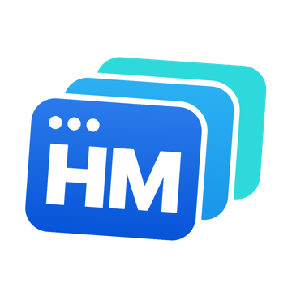
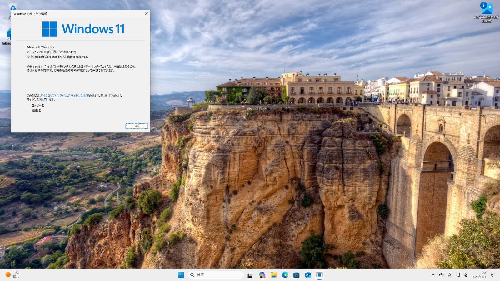
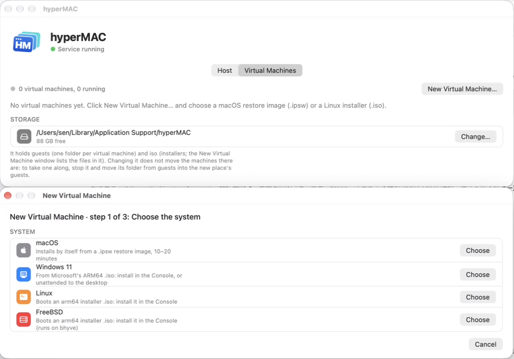
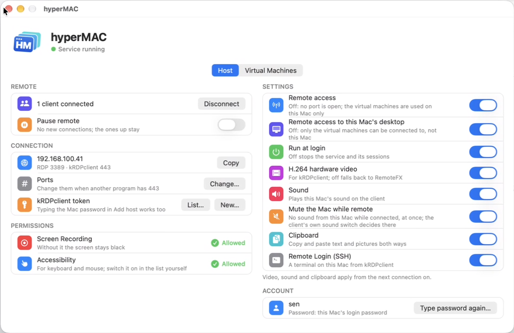
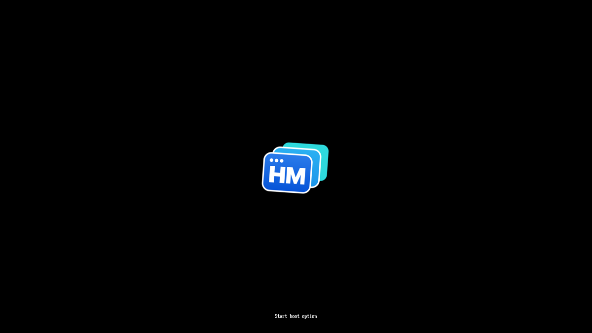
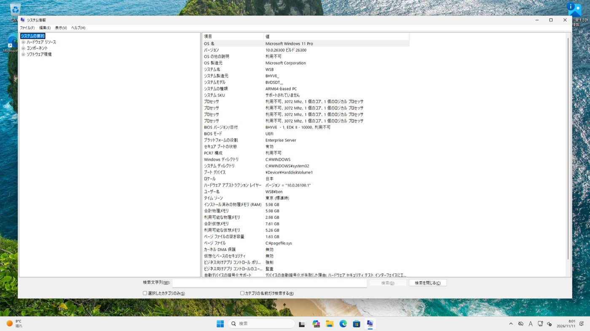

<p align="center"></p>
<h1 align="center">hyperMAC</h1>
<p align="center"><b>点三下，在 Mac 上跑起 Windows 11。免费、开源、不用 QEMU。</b><br>
Apple Silicon 上的 bhyve + 苹果的 Virtualization.framework + 内置 RDP 服务端，一个 app。</p>
<p align="center"><a href="https://github.com/keelos-dev/hyperMAC/releases">下载</a> · <a href="#三步装好-windows-11">三步装好 Windows 11</a> · <a href="#和别家比">和别家比</a> · <a href="README.md">English</a></p>



hyperMAC 做两件事，而且两件事正好配套：

1. **虚拟机。** 在 Apple Silicon 上跑 macOS、Windows 11 ARM、Linux、FreeBSD。Windows 和 FreeBSD 跑在 **bhyve** 上：
   FreeBSD 的 hypervisor，移植到了苹果的 Hypervisor.framework——据我们所知这是 Apple Silicon 上的第一个 bhyve。
   macOS 和 Linux 跑在苹果自己的 Virtualization.framework 上。
2. **RDP 服务端。** 这台 Mac 自己的桌面和每一台虚拟机都能用标准 RDP 连：Windows 自带的 `mstsc` 直接连，什么都不用装。
   柜子里的一台 Mac mini，就成了能从任何 PC 上用的 Windows + Mac 服务器。

不想要第二件？一个开关关掉所有端口，它就是个本机的虚拟机软件。

| 新建虚拟机：选一个系统 | 这台 Mac 自己：远程连接，每项一个开关 |
|---|---|
|  |  |

## 为什么值得一试

- **Windows 11 ARM 用微软原版 ISO 原样安装。** 虚拟机带 TPM 2.0 和 Secure Boot，安装程序的硬件检查原样通过：
  不改注册表，不用改过的镜像。选「无人值守」，M4 上大约 8 分钟到桌面，账号建好，网络通。
- **免费、开源。** MIT，bhyve 移植部分 BSD-2-Clause。没有订阅、没有账号、没有遥测。
- **小而原生。** 一个约 30 MB 的 app：Rust 和 C，不用 QEMU，没有内核扩展，没有以 root 运行的后台服务。一台虚拟机就是一个普通进程。
- **天生无头。** 虚拟机在 Mac 上不开窗口，关掉 app 的窗口照样运行。要看就开控制台窗口，或者从别的电脑用 RDP 连。
- **两个引擎，各用所长。** macOS 和 Linux 用苹果的 Virtualization.framework（苹果官方支持的路）；
  Windows 和 FreeBSD 用 bhyve——Virtualization.framework 不管的地方。

## 三步装好 Windows 11

1. 准备两个文件：[微软官网](https://www.microsoft.com/software-download/windows11arm64)的 **Windows 11 ARM64 ISO**，
   和 [virtio-win 驱动 ISO](https://fedorapeople.org/groups/virt/virtio-win/direct-downloads/)（网卡驱动）。放进「下载」。
2. 打开 hyperMAC →「**虚拟机**」→「**新建虚拟机…**」→ **Windows 11**。两个文件它自己会找到。
3. 点「**创建**」，再点「**启动**」。在控制台窗口里像真机一样装；或者打开「无人值守」，填用户名和密码，8 分钟后回来。

就这些。不用绕过 TPM，不会看到「这台电脑无法运行 Windows 11」。

| 固件告诉你这是哪儿 | Windows 也认它是一台正经的安全 PC |
|---|---|
|  |  |

macOS 虚拟机一样短：「新建虚拟机… → macOS → 从苹果下载最新的 macOS」，之后全自动。Linux 和 FreeBSD：指给它发行版的 arm64 ISO。

## 能跑什么

| 系统 | 引擎 | 怎么装 | 状态 |
|---|---|---|---|
| **Windows 11 ARM** | bhyve + Hypervisor.framework | 微软的 ISO：手动，或无人值守 | TPM 2.0、Secure Boot、网络、1920x1080、Windows Update |
| **macOS** | Virtualization.framework | 全自动，用苹果的恢复映像（可代为下载） | 苹果框架给什么就是什么 |
| **Linux**（arm64） | Virtualization.framework | 发行版的 ISO | 测过 Fedora |
| **FreeBSD**（arm64） | bhyve + Hypervisor.framework | 官方 ISO | 测过 15.1 |

## 和别家比

按各家公开文档整理（2026-11），没有全部并排实测。有不对的地方欢迎提 issue。

| | **hyperMAC** | UTM | Parallels Desktop | VMware Fusion | VirtualBox |
|---|---|---|---|---|---|
| 价格 | 免费 | 免费 | 付费订阅 | 免费 | 免费 |
| 开源 | ✅ MIT / BSD | ✅ | ❌ | ❌ | ✅（GPL） |
| 虚拟化核心 | bhyve + Hypervisor.framework；苹果 VZ | QEMU；苹果 VZ | 自研 | 自研 | 自研 |
| Windows 11 ARM | ✅ | ✅ | ✅ | ✅ | ✅（7.2 起） |
| macOS 虚拟机 | ✅ | ✅ | ✅ | ❌ | ❌ |
| Windows 里的 3D 加速 | ❌ 还没有 | ❌ | ✅ | ✅ | ❌ |
| RDP 连 Mac 自己的桌面和每台虚拟机 | ✅ 内置 | ❌ | ❌ | ❌ | 只有虚拟机（VRDE） |

说实话：要在 Windows 里打游戏、跑 3D，Parallels 领先，而且还会领先一阵。要的是用 Windows 11 跑 Office、浏览器、
开发工具，或者那一个只有 Windows 版的程序，Mac 甚至可能没接显示器，又不想每年为此付费——那就是它了。

## RDP 服务端

hyperMAC 最早就是 Mac 自己的 RDP 服务端，这部分是成熟的。

- **`mstsc` 直接连**（`Mac地址:3389`，用 Mac 的用户名和密码）。
- 用 **[kRDPclient](https://github.com/keelos-dev/kRDPclient-releases)**（Windows，免费）有硬件 H.264：1080p 30 fps
  （局域网 60），约 6–10 Mbps，带声音和剪贴板。它列出这台 Mac 和每一台虚拟机，点一下就进。
- 登录用的就是你的 Mac 账号，中间不经过任何云服务。
- 免费——NoMachine 已经不是了：它从 10 版起取消了免费的服务端，个人使用也要按年订阅。

### 和其他 Mac 远程桌面比较

按各家公开说明整理（2026-11），没有全部并排实测。

| | hyperMAC | Apple 屏幕共享 | NoMachine | Chrome 远程桌面 | RustDesk | Parsec |
|---|---|---|---|---|---|---|
| 协议 | RDP | VNC + Apple 扩展 | NX | WebRTC | 自有 | 自有 |
| 视频编码 | H.264 硬编（kRDPclient）；RemoteFX / 位图（mstsc）；声音 Opus / PCM | VNC 编码（Raw/ZRLE/Tight…）；高性能模式 HEVC（两端都是 Apple Silicon Mac） | H.264、VP8 | VP8 / VP9（WebRTC） | VP8 / VP9 / AV1，可选硬件 H.264 / H.265 | H.264、H.265 |
| Windows 自带 mstsc 能直连 | ✅ | ❌ | ❌ | ❌ | ❌ | ❌ |
| 要账号/云服务 | 不要 | 不要 | 不要（局域网） | 要 Google 账号 | 不要（可自建中继） | 要 |
| 给 Windows 客户端的硬件视频 | ✅ H.264（kRDPclient） | ❌ | ✅ | — | ✅ | ✅ |
| 流畅度（Windows 客户端） | 流畅：1080p 30 fps（局域网可 60），实测解码 7.6 ms、6–10 Mbps、Mac CPU 约 6% | 卡（TigerVNC 实测） | 流畅 | 一般 | 较流畅 | 很流畅（游戏级延迟） |
| 声音 | ✅ | 只有高性能模式（Mac 客户端） | ✅ | ✅ | ✅ | ✅ |
| 文件传输 | ❌（计划中） | ✅（Mac 客户端） | ✅ | ❌ | ✅ | ❌ |
| 停在登录窗口时能连 | ❌ | ✅ | ✅ | ✅ | ✅ | — |
| 价格 | 免费 | 系统自带 | 10 起收费（个人使用也要订阅） | 免费 | 开源 | 个人免费 |

适合的场景：对面是 Windows，想用标准 RDP（mstsc 什么都不用装，或者 kRDPclient 走 H.264 硬件编解码），
中间不经过任何云账号。

### 功能 × macOS 版本

✅ 真机实测 · ☑️ 应该能用，这个版本还没测 · — 没测

| 功能 | 13–15 | 26 | 27.2 |
|---|:-:|:-:|:-:|
| kRDPclient：登录、H.264 硬件画面 | — | ✅ | ✅ |
| mstsc 等标准 RDP 客户端（RemoteFX） | — | ✅ | ☑️ |
| 键鼠（输入法可用） | — | ✅ | ✅ |
| 声音（kRDPclient 用 Opus，mstsc 用 PCM） | — | ✅ | ☑️ |
| 剪贴板：文字 | — | ✅ | ☑️ |
| 剪贴板：图片 | — | ✅ | ✅ |
| kRDPclient「Discover keelOS」自动发现 | — | ✅ | ☑️ |
| 后台运行、登录自启 | — | ✅ | ✅ |
| macOS 升级后授权不丢 | — | — | ✅（26 → 27.2） |
| app、首次设置、检查更新 | — | ✅ | ☑️ |

## 安装

1. 从 [Releases](https://github.com/keelos-dev/hyperMAC/releases) 下载最新的 `.dmg` 并打开（已签名并经苹果公证）。
2. 把 **hyperMAC** 拖进「应用程序」并打开。
3. 第一次运行：输一次 Mac 的登录密码（远程客户端就用它登录），允许「屏幕录制」和「辅助功能」。
   只想用虚拟机？在那一页点「只用虚拟机，跳过」，两项都不用给。

要求：Apple Silicon 的 Mac，在 macOS 26 和 27 上测过。不支持 Intel Mac。

## 用什么 RDP 客户端

**推荐 kRDPclient**：https://github.com/keelos-dev/kRDPclient-releases （Windows）。
在 kRDPclient 里「添加 keelOS 主机」，填 Mac 的地址和 Mac 的登录密码（kRDPclient 拿它换
一个 token，不保存密码），也可以填 hyperMAC app 里生成的 token。画面走硬件
编码的 H.264，声音、剪贴板也都有。

mstsc（远程桌面连接）等标准 RDP 客户端也能连（`Mac地址:3389`，用 Mac 的用户名和登录密码），
**但它们没有 H.264 通道**，画面走 RemoteFX / 位图，流畅度差一截。用 mstsc 觉得卡的话，
请先换 kRDPclient 试试。

### RDP 服务端的限制

- Mac 上要有用户登录着：停在登录窗口（比如重启后没开自动登录）时连不上。建议在「系统设置 →
  用户与群组」里打开自动登录。
- Mac 要接着显示器，或者插一个假负载（HDMI 欺骗器）；什么都不接时 macOS 没有屏幕可抓。
- 剪贴板支持文字和图片（截图、复制的图片），文件还不支持。
- 鼠标指针是画在画面里的，还没有客户端本地光标。
- 登录用的就是你的 Mac 账号，知道 Mac 密码的人就能连：密码要设好，3389/443 端口别暴露到公网。
  hyperMAC 不保存密码本身，只为 mstsc 存一个密码的 NT 哈希（只有你的账号能读）。改了 Mac 密码后旧密码
  立刻失效；kRDPclient 马上能用新密码，mstsc 要先用新密码从 kRDPclient 登录一次（或者打开 hyperMAC 输一次）。
- 不会自己检查更新：在 app 里点「检查更新…」。

## 还毛糙的地方

- **它还很新。** 虚拟机部分刚做出来。重要的东西请留备份。
- Windows 里没有显卡加速（基本显示驱动，最大 1920x1200），虚拟机还没有声音。
- 桥接网络、睡眠唤醒、长时间运行测得还不够。
- 固件的 Secure Boot 把密钥放在来宾内核够得着的地方（这个 EDK2 平台没有受保护的变量存储）：满足 Windows 的要求，但不是真机的强度。

## 给好奇的人：Apple Silicon 上的 bhyve

[xhyve](https://github.com/machyve/xhyve) 在 2015 年把 bhyve 带到了 Intel Mac。这里的 `vm/bhyve` 是 arm64 的故事：

- FreeBSD 的 `usr.sbin/bhyve` 源码**原样不动**，上面是一串带编号的补丁和一层很薄的兼容层，跟 FreeBSD head 的成本很低。
- `libvmmapi` 在 **Hypervisor.framework** 上重新实现（`vm/bhyve/hvf`，约 2000 行）：vCPU、框架自带的内核 GICv3、
  经 GICv2m 的 MSI、CPU 不给解码信息的 MMIO 指令的解码。
- arm64 的 bhyve 原来没有、而 Windows 需要的：**UEFI**（EDK2）、**ACPI** 表、存 UEFI 变量的 CFI 闪存、QEMU 的 fw_cfg 和 ramfb、
  **virtio 1.0** 接口、**TPM**（libtpms 在进程内）、Secure Boot。
- 其中 18 个补丁是按提给 FreeBSD review 写的，包括一路上发现的缺陷（`vm/bhyve/patches/REVIEW.md`）。还没有提交。

## 更新

打开 hyperMAC，点「关于」里的「检查更新…」。有新版本时会列出改了什么；点「更新」会下载新版本、
核对它是 hyperMAC 开发者签名并经苹果公证的，替换 app 并重启服务（正在连着的会话会断开几秒），授权
不用重新给。

手动覆盖：先退出 hyperMAC 的窗口（⌘Q；窗口开着时 Finder 不让覆盖，会说「hyperMAC 正在使用」），
再把新的 hyperMAC 拖进去覆盖，然后打开它。后台服务不用停。

### 卸载

1. 打开 hyperMAC，选「卸载自启」。
2. 删掉「应用程序」里的 hyperMAC 和文件夹 `~/Library/Application Support/hyperMAC`。
3. 可选：在「系统设置」的「屏幕录制」「辅助功能」里把 hyperMAC 删掉。

远程登录（SSH）是 macOS 自己的设置，卸载时不动它；不需要了就在「系统设置 → 通用 → 共享」里关掉。

## 从源码编译

需要 Xcode 命令行工具、Rust（rustup，stable）和 Python 3；Windows 虚拟机的 TPM 还要
`brew install libtpms openssl`（没有的话 bhyve 照常能编，只是不带 TPM）。

```sh
sh build.sh        # target/release/hypermac、vm/target/release/hypermac（虚拟机程序）、vm/bhyve/build/bhyve
```

钥匙串里有 "Apple Development" 证书时 `build.sh` 用它签名（重新编译后两项授权不丢），否则是 ad hoc 签名。
`target/release/hypermac install` 装成登录自启。各部分怎么配合、发布怎么打包见
[docs/DEVELOPING.md](docs/DEVELOPING.md)；虚拟机部分见 [vm/README.md](vm/README.md) 和 [vm/bhyve/README.md](vm/bhyve/README.md)。

这个仓库每次发版从开发仓库收到一份快照，一版一个提交。欢迎提 pull request：合并后会带进开发仓库，下一份快照里就有。

### 许可证

hyperMAC 自己的代码：MIT（[LICENSE](LICENSE)）。`vm/bhyve`（把 FreeBSD 的 bhyve 移植到 Hypervisor.framework）：
BSD-2-Clause（[vm/bhyve/LICENSE](vm/bhyve/LICENSE)）；`vm/bhyve/freebsd` 里 FreeBSD 的文件保留各自的文件头。

## 第三方软件

hyperMAC 基于 [IronRDP](https://github.com/Devolutions/IronRDP)（MIT / Apache-2.0）和其他开源
Rust crate；虚拟机部分用了 FreeBSD 的 [bhyve](https://bhyve.org)（BSD 许可）和 [EDK2](https://www.tianocore.org)
UEFI 固件（BSD-2-Clause-Patent）。它们的声明随每份副本一起发：dmg 根目录和 `hyperMAC.app/Contents/Resources/` 里的
`THIRD_PARTY.md`、`LICENSE-IronRDP-MIT`、`THIRD_PARTY-crates.txt`、`THIRD_PARTY-vm.txt`。
